<p align="center"></p>

# Empyrion Linux Bridge (ELB)

*Документация на русском. [English version further down](#elb--empyrion-linux-bridge-english).*

Набор инструментов для администрирования игрового сервера [Empyrion Galactic
Survival](https://empyriononline.com/). Рассчитан на Linux-хостинг и btrfs
(instant CoW-снапшоты игровых данных вместо файлового бэкапа). 
Стек — Linux + wine, так как нативной версии игрового сервера под Linux на текущий момент нет.

## Скриншоты

<table>
<tr>
<td>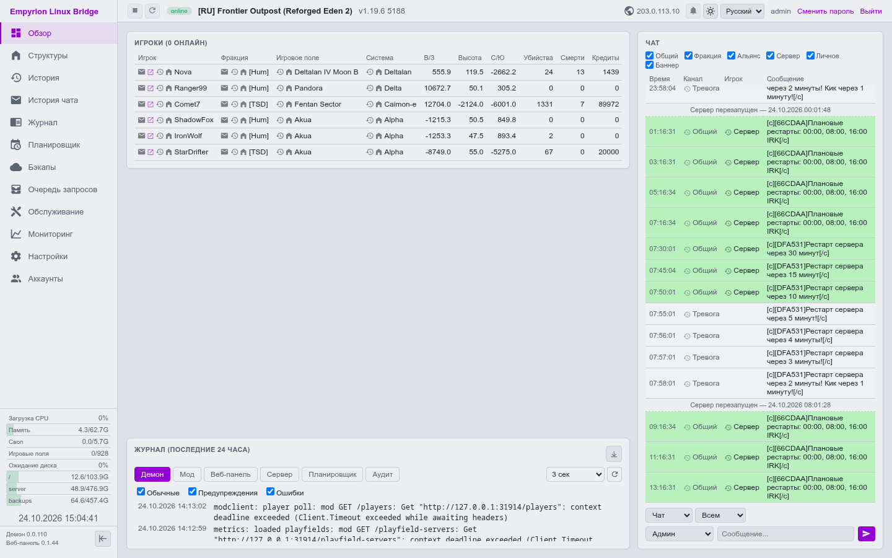</td>
<td>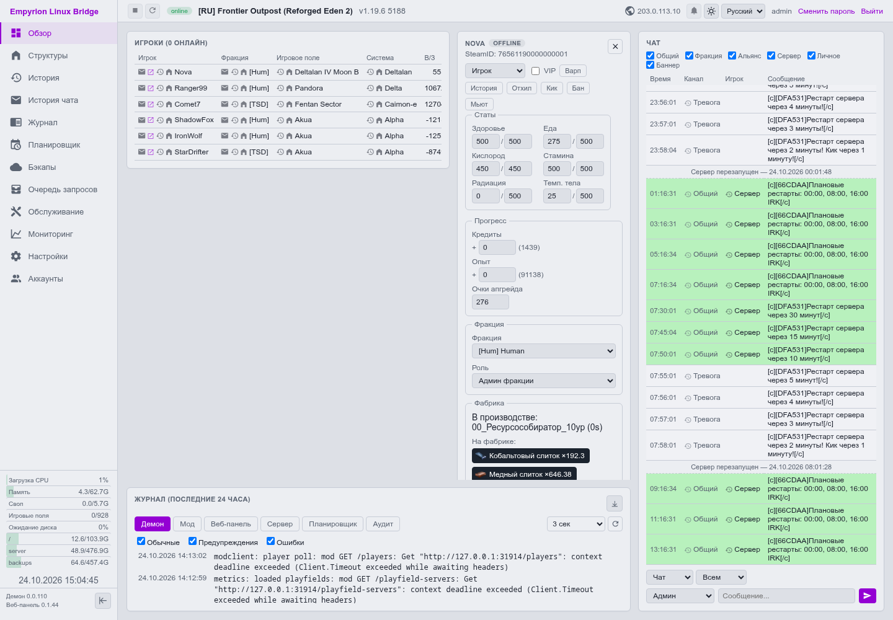</td>
</tr>
<tr>
<td>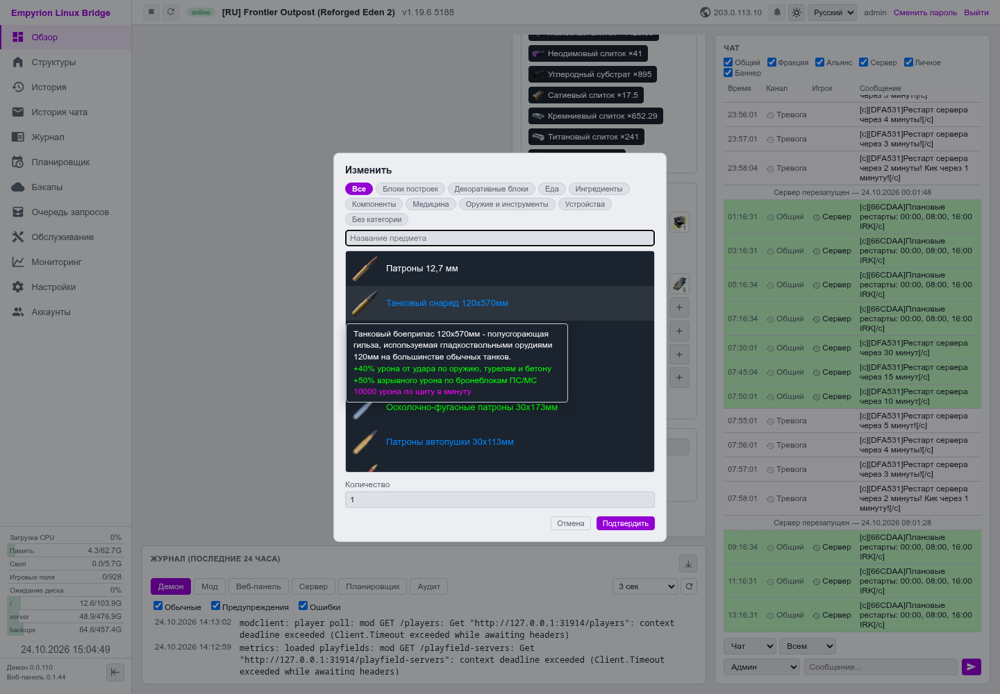</td>
<td>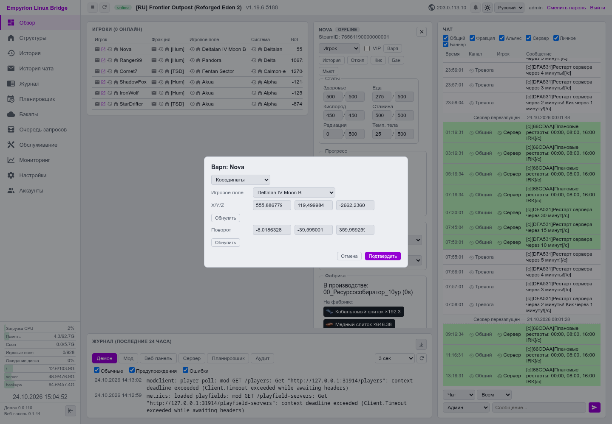</td>
</tr>
<tr>
<td>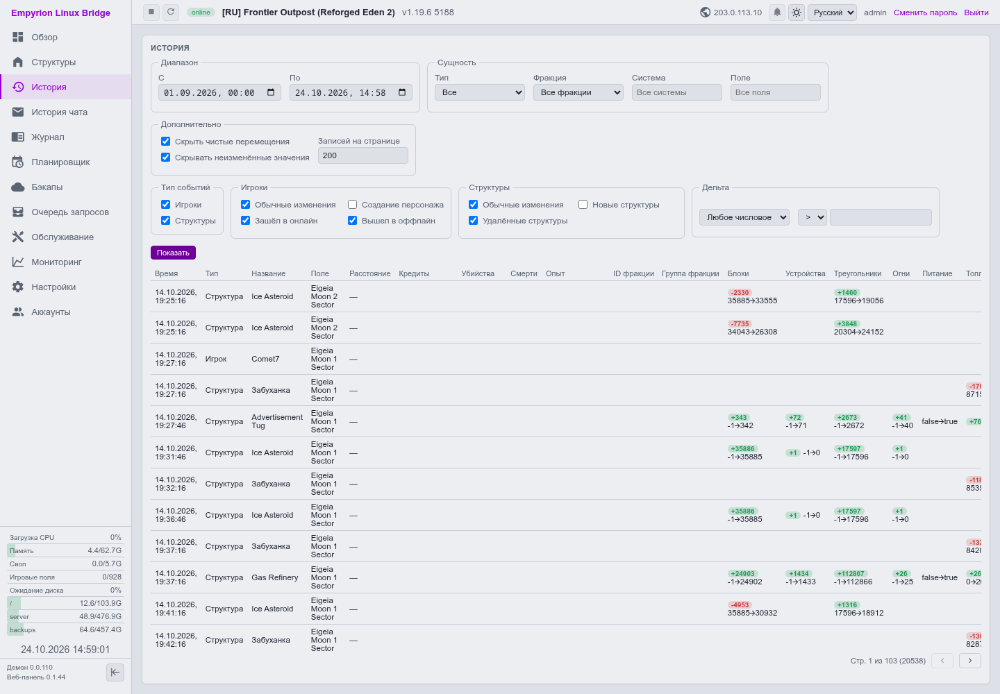</td>
<td>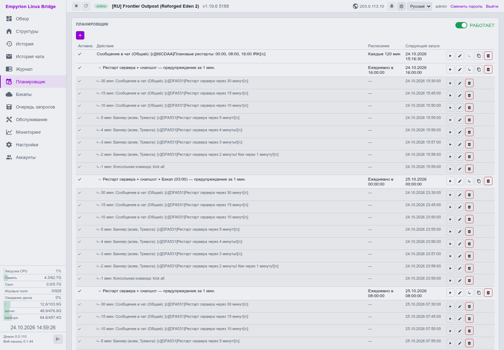</td>
</tr>
<tr>
<td>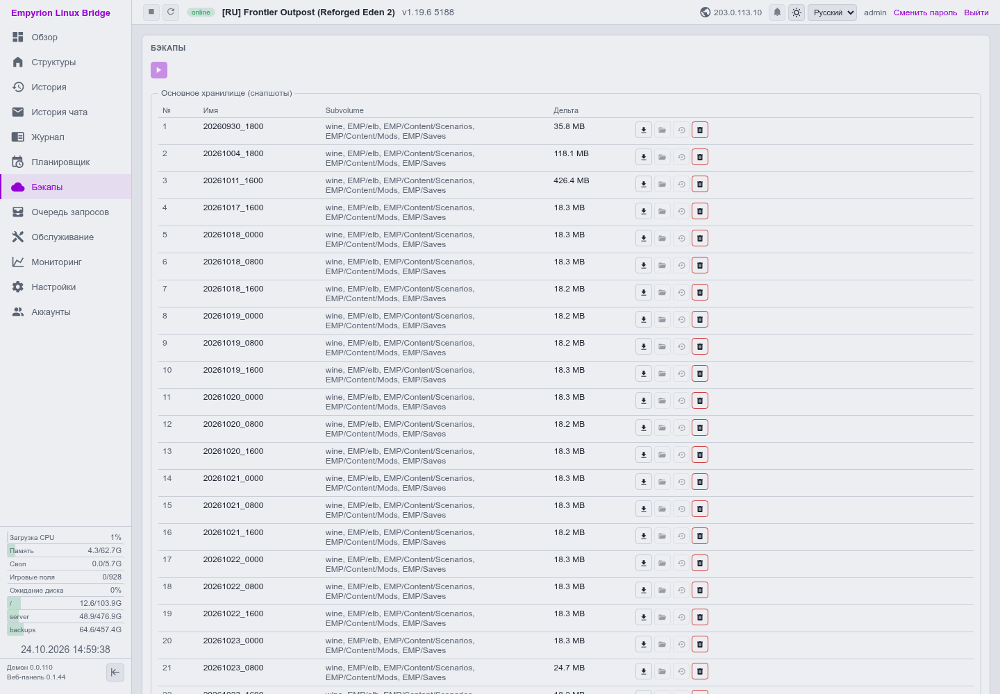</td>
<td>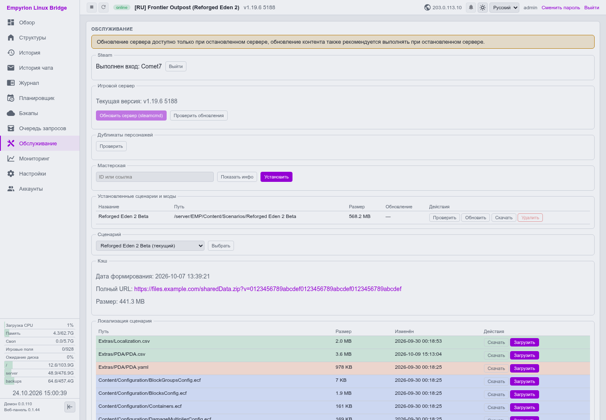</td>
</tr>
<tr>
<td>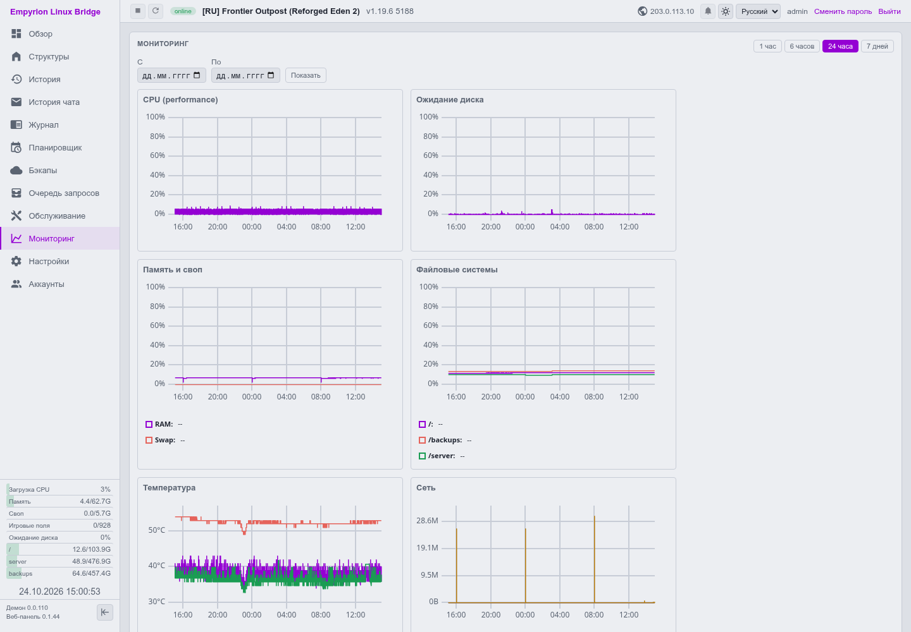</td>
<td>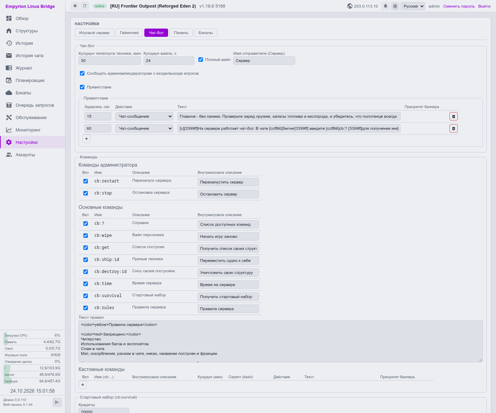</td>
</tr>
<tr>
<td>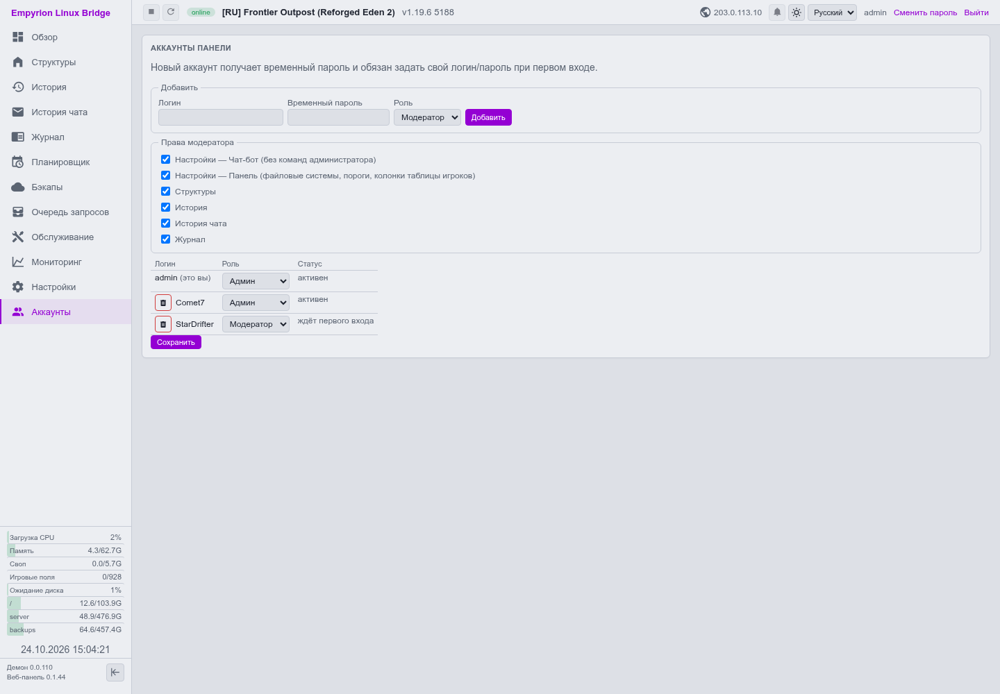</td>
<td></td>
</tr>
</table>

## Компоненты

Набор состоит из нескольких компонентов:

- **ElbMod** — DLL-модуль (C#/.NET Framework 4.8), загружается в процессе запуска игрового сервера,
  поднимает локальный API, к которому подключается daemon.
- **Daemon** — бинарный файл (Go) + systemd-сервис на Linux-хосте: управляет
  btrfs-снапшотами, жизненным циклом wine-процесса сервера, обновлениями
  через steamcmd, проксирует API мода наружу по HTTPS+Bearer-токенам.
- **UI** — веб-интерфейс (Go + htmx + WebSocket), позволяет управлять работой игрового сервера через
  запросы к Daemon, а также взаимодействовать с внутриигровыми функциями, как инструмент для администрирования игры.

## Установка

**Требования к серверу**:

- CPU/RAM подбираются под количество игроков.
- SSD/NVME накопитель крайне рекомендуется, как для самого игрового сервера, так и для работы Wine.
  Опытным путем было установлено, что медленная дисковая подсистема приводит к зависаниям процессов под Wine.
- Btrfs-раздел, либо отдельный диск/раздел с достаточным размером для последующего форматирования.
  Рекомендуется не менее 50Гб для сценария - игровой сервер + только 1 снапшот. 
  Для большого количества снапшотов и длительной работы сервера лучше рассматривать от 250Гб+.
  В любом случае - иметь хороший запас никогда не будет лишним.
- ОС - чистый сервер с Debian 12/13 (минимальная установка), так как весь инструментарий тестировался именно на ней.

Ниже описаны два варианта установки: через автоматический скрипт на чистую машину, либо ручная установка по шагам.
Так как будут выполняться привилегированные операции, скрипту нужны соответствующие права - либо через sudo, либо выполнять под root-пользователем.

### Вариант 1 — автоматический

```
wget -qO bootstrap.sh https://raw.githubusercontent.com/maximalmax90/EmpyrionLinuxBridge/main/installer/bootstrap.sh
sudo bash bootstrap.sh
```
Скрипт задаёт несколько вопросов и дальше делает всё самостоятельно. По итогу выдает все необходимые данные для начала использования.
В случае сбоя на одном из шагов (кроме необратимых), возможно перезапустить процесс, добавив ключ `--resume`

### Вариант 2 — вручную

Ниже описан процесс установки под root-пользователем варианта "все на одном сервере".
По сути все то, что делает скрипт в автоматическом режиме.

#### 0. Системный пользователь

Игровой сервер и Xvfb работают от отдельного технического пользователя (empyrion),
демон меняет владельца файлов сам, где нужно, поэтому для начала нужно создать пользователя:

```
useradd --system --create-home --home-dir /home/empyrion --shell /usr/sbin/nologin empyrion
```

#### 1. Пакеты

`steamcmd` лежит в `contrib`/`non-free` — на минимальной установке их
обычно нет и нужно добавить их в `/etc/apt/sources.list`. Также потребуется репозиторий
WineHQ + i386 мультиархитектура.

**Для Debian 12 (bookworm):**

```
sed -i -E 's/^(deb(-src)? [^ ]+ bookworm(-security|-updates)? main)([^#]*)$/\1 contrib non-free non-free-firmware/' /etc/apt/sources.list

dpkg --add-architecture i386
mkdir -p /etc/apt/keyrings
wget -qO /etc/apt/keyrings/winehq-archive.key https://dl.winehq.org/wine-builds/winehq.key
wget -qO /etc/apt/sources.list.d/winehq-bookworm.sources \
  https://dl.winehq.org/wine-builds/debian/dists/bookworm/winehq-bookworm.sources
```

**Для Debian 13 (trixie):**

```
sed -i -E 's/^(deb(-src)? [^ ]+ trixie(-security|-updates)? main)([^#]*)$/\1 contrib non-free non-free-firmware/' /etc/apt/sources.list

dpkg --add-architecture i386
mkdir -p /etc/apt/keyrings
wget -qO /etc/apt/keyrings/winehq-archive.key https://dl.winehq.org/wine-builds/winehq.key
wget -qO /etc/apt/sources.list.d/winehq-trixie.sources \
  https://dl.winehq.org/wine-builds/debian/dists/trixie/winehq-trixie.sources
```

**Установка пакетов:**

```
echo "steam steam/question select I AGREE" | debconf-set-selections
echo "steam steam/license note" | debconf-set-selections

apt-get update
DEBIAN_FRONTEND=noninteractive apt-get install -y --no-install-recommends \
  ca-certificates wget openssl \
  winehq-stable xvfb steamcmd btrfs-progs zstd python3-venv auditd

systemctl enable --now auditd
```

Python-venv потребуется для извлечения иконок предметов базовой игры:

```
mkdir -p /opt/elb
python3 -m venv /opt/elb/iconextract-venv
/opt/elb/iconextract-venv/bin/pip install --upgrade pip
/opt/elb/iconextract-venv/bin/pip install UnityPy Pillow
```

#### 2. btrfs

Если уже есть нужный смонтированный раздел, то этот шаг можно пропустить. 
Если есть чистый диск/раздел, то его нужно отформатировать и смонтировать:

```
mkfs.btrfs -f /dev/sdX
mkdir -p /server
echo "UUID=$(blkid -s UUID -o value /dev/sdX) /server btrfs defaults 0 0" >>/etc/fstab
mount /server
```

#### 3. Раскладка каталогов/subvolume

В снапшоты попадает только необходимый минимум, чтобы не раздувать их чрезмерно:
- `wine` - префикс, как правило в снапшотах не будет занимать места, но добавлен на всякий случай
- `EMP/elb` - данные демона
- `EMP/Content/Scenarios` - сценарии игры
- `EMP/Content/Mods` - моды игры, в том числе наш мод
- `EMP/Saves` - сохранения.
Все это отдельные subvolume.

`EMP` и `EMP/Content` — обычные каталоги. Ниже расписан процесс создания всего вышеописанного:

```
mkdir -p /server/EMP/Content
for sv in wine EMP/elb EMP/Content/Scenarios EMP/Content/Mods EMP/Saves; do
  btrfs subvolume create "/server/$sv"
done
mkdir -p /server/backups

chown -R empyrion:empyrion /server/EMP /server/wine
chown empyrion:empyrion /server/backups
```

#### 4. Инициализация wine

Ниже описан правильный порядок инициализации, полученный путем проб и ошибок.

Сначала проверьте наличие `xvfb.service`, если его нет, то необходимо его создать:

```
cat > /etc/systemd/system/xvfb.service <<'EOF'
[Unit]
Description=X Virtual Frame Buffer Service
After=network.target

[Service]
ExecStart=/usr/bin/Xvfb :0 -screen 0 320x240x16
User=empyrion
Group=empyrion
Restart=on-failure

[Install]
WantedBy=multi-user.target
EOF
```

Запускаем (если ранее не было или не запущен):

```
systemctl daemon-reload
systemctl enable --now xvfb.service
```

Инициализуем префикс без установки mono/gecko (gecko в принципе не понадобится):

```
runuser -u empyrion -- env DISPLAY=:0.0 WINEARCH=win64 WINEPREFIX=/server/wine \
WINEDEBUG=-all WINEDLLOVERRIDES="mscoree,mshtml=" /opt/wine-stable/bin/wineboot --init
```

Дальше нужна версия wine-mono не ниже той, что зашита в исходниках именно установленного релиза wine.

Узнаем нужную версию:

```
WINE_VER=$(/opt/wine-stable/bin/wine --version | sed -n 's/^wine-//p')
MONO_VER=$(wget -qO- "https://gitlab.winehq.org/wine/wine/-/raw/wine-$WINE_VER/dlls/appwiz.cpl/addons.c" \
  | grep -m1 -oP '^#define\s+MONO_VERSION\s+"\K[^"]+')
```

Если пусто — повторить с сокращённой версией:

```
MONO_VER=$(wget -qO- "https://gitlab.winehq.org/wine/wine/-/raw/wine-${WINE_VER%.*}/dlls/appwiz.cpl/addons.c" | grep -m1 -oP '^#define\s+MONO_VERSION\s+"\K[^"]+')
```

Скачиваем и устанавливаем:

```
wget -qO "/tmp/wine-mono-$MONO_VER-x86.msi" \
  "https://dl.winehq.org/wine/wine-mono/$MONO_VER/wine-mono-$MONO_VER-x86.msi"
runuser -u empyrion -- env DISPLAY=:0.0 WINEARCH=win64 WINEPREFIX=/server/wine WINEDEBUG=-all \
  /opt/wine-stable/bin/wine msiexec /i "/tmp/wine-mono-$MONO_VER-x86.msi" /qn
rm -f "/tmp/wine-mono-$MONO_VER-x86.msi"
```

#### 5. Установка игрового сервера через steamcmd

Самое важное - запускать от нашего сервисного пользователя (`empyrion`):

```
runuser -u empyrion -- /usr/games/steamcmd \
  +force_install_dir /server/EMP \
  +login anonymous \
  +app_update 530870 validate \
  +quit
```

**Включите Telnet** — стоковый `dedicated.yaml` несёт эту секцию
закомментированной, а демон читает `Tel_Port`/`Tel_Pwd` именно из этого
файла (без этого не будет работать демон и, как следствие - веб-панель):

```
sed -i \
  -e "s/^[[:space:]]*#\{0,1\}[[:space:]]*Tel_Enabled:.*/    Tel_Enabled: true/" \
  -e "s/^[[:space:]]*#\{0,1\}[[:space:]]*Tel_Port:.*/    Tel_Port: 30004/" \
  -e "s/^[[:space:]]*#\{0,1\}[[:space:]]*Tel_Pwd:.*/    Tel_Pwd: $(openssl rand -hex 8)/" \
  /server/EMP/dedicated.yaml
```

#### 6. Обёртка запуска + systemd-юниты игрового сервера

`EmpyrionLauncher.exe` — bootstrap-процесс, сам завершается сразу после спавна настоящего `EmpyrionDedicated.exe`;
под systemd (`KillMode=control-group`) нельзя просто его выполнить — сразу завершит всё дерево процессов.
Нужен поллинг (`pgrep`).

Для начала создайте `/server/empyrion.env`:

```
cat > /server/empyrion.env <<'EOF'
DISPLAY=:0.0
WINEARCH=win64
WINEPREFIX=/server/wine
WINEDEBUG="-all"
EOF
```

После создайте `/server/server.sh`:

```
cat > /server/server.sh <<'SRVEOF'
#!/bin/bash
set -a
. /server/empyrion.env
set +a

DEDI_YAML=/server/EMP/dedicated.yaml
TEL_PORT=$(grep -oP 'Tel_Port:\s*\K\S+' "$DEDI_YAML")
TEL_PWD=$(grep -oP 'Tel_Pwd:\s*\K\S+' "$DEDI_YAML")

case "$1" in
start)
	/opt/wine-stable/bin/wineboot --init
	sleep 10
	cd /server/EMP
	/opt/wine-stable/bin/wine EmpyrionLauncher.exe -startDedi -dedicated dedicated.yaml
	sleep 3
	while pgrep -f "EmpyrionDedicated.exe" >/dev/null 2>&1; do
		sleep 2
	done
	;;
stop)
	python3 - "$TEL_PORT" "$TEL_PWD" <<'PYEOF'
import socket, sys, time

port, pwd = int(sys.argv[1]), sys.argv[2]
s = socket.socket(socket.AF_INET, socket.SOCK_STREAM)
s.settimeout(15)
try:
	s.connect(("127.0.0.1", port))
	time.sleep(1)
	s.recv(4096)
	s.sendall((pwd + "\n").encode())
	time.sleep(1)
	s.recv(4096)
	s.sendall(b"saveandexit 0\n")
	time.sleep(2)
except OSError:
	pass
finally:
	s.close()
PYEOF
	for i in $(seq 1 30); do
		pgrep -f "EmpyrionLauncher.exe" >/dev/null 2>&1 || break
		sleep 1
	done
	/opt/wine-stable/bin/wineserver -k
	;;
*)
	echo "Usage: $0 {start|stop}"
	exit 1
	;;
esac
SRVEOF
```

Выставляем нужные права и владельца:

```
chmod 755 /server/server.sh
chown empyrion:empyrion /server/server.sh /server/empyrion.env
```

(если у вас btrfs не в `/server`, то это нужно будет везде поменять на свой вариант)

Создаем сервис:

```
cat > /etc/systemd/system/empyrion.service <<'EOF'
[Unit]
Description=Empyrion Dedicated Server
Requires=xvfb.service
After=xvfb.service

[Service]
Type=simple
ExecStartPre=+/usr/local/bin/elb-daemon scenario-cache prepare
ExecStart=/server/server.sh start
ExecStop=/server/server.sh stop
TimeoutStopSec=60
Restart=always
RestartSec=5
User=empyrion
Group=empyrion

[Install]
WantedBy=multi-user.target
EOF
```

`ExecStartPre` готовит раздачу SharedData активного сценария по прямой
ссылке вместо встроенной игровой передачи (та на больших сценариях может
рвать связь уже играющим при заходе новых игроков) — по умолчанию
выключено, настраивается после установки в панели (Настройки → Игровой
сервер → Кэш сценария). `+` в начале строки — выполняется от root
независимо от `User=empyrion` ниже (демону нужен доступ к
`dedicated.yaml`/`settings.json`, которых у пользователя `empyrion` нет).

Активируем (но не запускаем, это будет сделано после в панели):

```
systemctl daemon-reload
systemctl enable empyrion.service
```

Начиная с этого шага нужны готовые бинарники (`elb-daemon`, `elb-ui`, ElbMod) — берём их из архива:

```
wget -qO elb-installer.tar.gz https://github.com/maximalmax90/EmpyrionLinuxBridge/releases/latest/download/elb-installer.tar.gz
mkdir elb-installer && tar -xzf elb-installer.tar.gz -C elb-installer
```

Нам нужны: 
`elb-installer/bin/elb-daemon`
`elb-installer/bin/elb-ui`
`elb-installer/bin/ElbMod/`

#### 7. ElbMod

```
mkdir -p /server/EMP/Content/Mods/ElbMod
cp -r elb-installer/bin/ElbMod/. /server/EMP/Content/Mods/ElbMod/
chown -R empyrion:empyrion /server/EMP/Content/Mods/ElbMod
```

#### 8. Демон

```
install -m 755 elb-installer/bin/elb-daemon /usr/local/bin/elb-daemon
```

Адрес прослушки (порт при желании можно сменить) — `127.0.0.1:8090`, если панель на этой же машине; иначе
`:8090`, чтобы панель на другом хосте достучалась:

```
cat > /etc/systemd/system/elb-daemon.service <<'EOF'
[Unit]
Description=ELB daemon
After=network.target

[Service]
Environment=ELB_HTTP_ADDR=127.0.0.1:8090
Environment=ELB_DEDICATED_YAML=/server/EMP/dedicated.yaml
Environment=ELB_DATA_ROOT=/server/EMP
Environment=ELB_BACKUPS_DIR=/server/backups
Environment=ELB_STEAMCMD_BIN=/usr/games/steamcmd
ExecStart=/usr/local/bin/elb-daemon
Restart=on-failure
User=root

[Install]
WantedBy=multi-user.target
EOF

systemctl daemon-reload
systemctl enable --now elb-daemon.service
```

Первый старт сам генерирует токен доступа и self-signed TLS-сертификат.
Получите значения для настройки панели — пригодятся в следующем шаге,
здесь просто сохраняем их в переменные той же сессии терминала:

```
DAEMON_TOKEN=$(python3 -c 'import json; print(json.load(open("/etc/elb/daemon.json"))["tokens"][0])')
DAEMON_FP=$(openssl x509 -in /etc/elb/tls.crt -noout -fingerprint -sha256 | sed 's/^.*=//; s/://g' | tr 'A-F' 'a-f')
echo "token: $DAEMON_TOKEN"
echo "fingerprint: $DAEMON_FP"
```

#### 9. Веб-панель

```
install -m 755 elb-installer/bin/elb-ui /usr/local/bin/elb-ui
mkdir -p /var/lib/elb-ui /etc/elb
```

`$DAEMON_TOKEN`/`$DAEMON_FP` — подставляются сами из предыдущего шага:

```
cat > /etc/elb/ui.json <<EOF
{
  "listen_addr": ":8081",
  "daemon_url": "https://127.0.0.1:8090",
  "daemon_token": "$DAEMON_TOKEN",
  "daemon_cert_fingerprint": "$DAEMON_FP",
  "db_file": "/var/lib/elb-ui/ui.db",
  "poll_interval_seconds": 3,
  "trust_proxy_headers": false
}
EOF
chmod 600 /etc/elb/ui.json
```

```
cat > /etc/systemd/system/elb-ui.service <<'EOF'
[Unit]
Description=ELB web UI
After=network.target elb-daemon.service

[Service]
ExecStart=/usr/local/bin/elb-ui
Restart=on-failure
User=root

[Install]
WantedBy=multi-user.target
EOF

systemctl daemon-reload
systemctl enable --now elb-ui.service
```

По итогу панель будет доступна по адресу http://<ip>:8081

Для первого входа используйте — `admin`/`admin`.

#### 10. (опционально) nginx перед панелью

Панель сама без TLS, если это удаленный сервер, то крайне желательно поставить перед ней nginx
с действующим или самоподписанным сертификатом. Сначала ставим сам nginx:

```
apt-get update
DEBIAN_FRONTEND=noninteractive apt-get install -y nginx
```

Генерируем сертификат:

```
mkdir -p /etc/nginx/elb
openssl req -x509 -nodes -newkey rsa:2048 -days 3650 \
  -keyout /etc/nginx/elb/elb-ui.key -out /etc/nginx/elb/elb-ui.crt \
  -subj "/CN=elb-ui"
```

Создаем конфиг:

```
cat > /etc/nginx/sites-available/elb-ui.conf <<'EOF'
server {
	listen 80;
	server_name _;
	return 301 https://$host$request_uri;
}

server {
	listen 443 ssl;
	server_name _;

	ssl_certificate /etc/nginx/elb/elb-ui.crt;
	ssl_certificate_key /etc/nginx/elb/elb-ui.key;

	client_max_body_size 200M;

	location / {
		proxy_pass http://127.0.0.1:8081;
		proxy_set_header Host $host;
		proxy_set_header X-Real-IP $remote_addr;
		proxy_set_header X-Forwarded-For $proxy_add_x_forwarded_for;
		proxy_set_header X-Forwarded-Proto $scheme;
		proxy_http_version 1.1;
		proxy_set_header Upgrade $http_upgrade;
		proxy_set_header Connection "upgrade";
	}
}
EOF

ln -sf /etc/nginx/sites-available/elb-ui.conf /etc/nginx/sites-enabled/elb-ui.conf
rm -f /etc/nginx/sites-enabled/default
nginx -t
systemctl enable --now nginx
systemctl reload nginx
```

Опционально в `/etc/elb/ui.json` можно включить `"trust_proxy_headers": true` - будет показывать реальные IP в журнале авторизации.

#### 11. Фаерволл

Общие рекомендации:
- Игровому серверу нужен **диапазон из 4 портов** начиная с `Srv_Port`,
  по умолчанию `30000-30003` tcp+udp. 
- Порт панели `8081` tcp, либо, если перед ней nginx - `80`/`443` tcp.
- Порт демона `8090` tcp - открывать, только если панель на другом сервере.
- Порт кэша сценария `8899` tcp - только если в Настройках выбран режим
  "Раздаёт сам демон" (по умолчанию фича выключена).
- Telnet-порт (`30004` по умолчанию) наружу НЕ открывать — это открытый
  текстовый протокол.

Ниже приведен пример на базе iptables (порядок важен — сначала
разрешающие правила, потом политика `DROP`, иначе можно себя же запереть
по SSH):

Сначала база — ставим iptables, разрешаем localhost/уже установленные
соединения/SSH и диапазон игрового сервера (нужен всегда):

```
apt-get update
DEBIAN_FRONTEND=noninteractive apt-get install -y iptables iptables-persistent

iptables -F INPUT
iptables -A INPUT -i lo -j ACCEPT
iptables -A INPUT -m state --state ESTABLISHED,RELATED -j ACCEPT
iptables -A INPUT -p tcp --dport 22 -j ACCEPT

for p in 30000 30001 30002 30003; do
  iptables -A INPUT -p tcp --dport $p -j ACCEPT
  iptables -A INPUT -p udp --dport $p -j ACCEPT
done
```

Дальше — по ситуации, выберите то, что подходит:

Панель БЕЗ nginx перед ней:

```
iptables -A INPUT -p tcp --dport 8081 -j ACCEPT
```

Панель ЗА nginx (вместо строки выше):

```
iptables -A INPUT -p tcp --dport 80 -j ACCEPT
iptables -A INPUT -p tcp --dport 443 -j ACCEPT
```

Демон — только если панель на ДРУГОМ сервере:

```
iptables -A INPUT -p tcp --dport 8090 -j ACCEPT
```

Кэш сценария (Настройки → Игровой сервер → Кэш сценария) в режиме "Раздаёт
сам демон" — свой порт (по умолчанию `8899`, настраивается в Настройках
или через `ELB_SCENARIO_CACHE_LISTEN_ADDR`), БЕЗ токена — его дёргает
напрямую игровой клиент, не панель:

```
iptables -A INPUT -p tcp --dport 8899 -j ACCEPT
```

Дальше — общий финал, применяем политику `DROP` и сохраняем:

```
iptables -P INPUT DROP
iptables -P FORWARD DROP

install -d /etc/iptables
iptables-save >/etc/iptables/rules.v4
netfilter-persistent save
```

(если уже используете ufw/firewalld/nftables — просто добавьте те же
порты через свой инструмент, ставить iptables поверх не нужно)

## Сборка из исходников

Не обязательна для установки, нужна только если хотите собрать всё сами.

Демон и панель — отдельные Go-модули (Go 1.27):

```
cd daemon && go build ./... && go test ./...
cd ui && go build ./...
```

Мод — .NET Framework 4.8 (MSBuild/`dotnet build`), требует `ModApi.dll`/
`Mif.dll` реального сервера рядом (путь — `GameServerDir` в
`ElbMod.csproj`, локально, не в git):

```
cd mod/ElbMod && dotnet build -c Release
```

## Источники и атрибуция

При создании частично использовались наработки следующих проектов —
преимущественно для разбора недокументированного протокола/API Empyrion:

- [EmpyrionWebAccess](https://github.com/GitHub-TC/EmpyrionWebAccess)
  (ASTIC/TC, GPLv3).
- [EmpyrionNetAPIAccess](https://github.com/GitHub-TC/EmpyrionNetAPIAccess)
  (Chris Wheeler / ASTIC-TC, MIT).
- [EmpyrionScripting](https://github.com/GitHub-TC/EmpyrionScripting)
  (ASTIC/TC, GPLv3).

## Лицензия

[MIT](LICENSE).

---


# ELB — Empyrion Linux Bridge (English)

*Russian documentation is above. This is the English version.*

A set of tools for administering an [Empyrion Galactic
Survival](https://empyriononline.com/) game server. Built for Linux
hosting and btrfs (instant CoW snapshots of game data instead of a
file-level backup). The stack is Linux + wine, since there's currently no
native Linux version of the game server.

## Screenshots

<table>
<tr>
<td></td>
<td></td>
</tr>
<tr>
<td></td>
<td></td>
</tr>
<tr>
<td></td>
<td></td>
</tr>
<tr>
<td></td>
<td></td>
</tr>
<tr>
<td></td>
<td></td>
</tr>
<tr>
<td></td>
<td></td>
</tr>
</table>

## Components

The set consists of several components:

- **ElbMod** — a DLL module (C#/.NET Framework 4.8), loaded during game
  server startup, exposes a local API that the daemon connects to.
- **Daemon** — a binary (Go) + systemd service on the Linux host: manages
  btrfs snapshots, the wine server process lifecycle, updates via
  steamcmd, proxies the mod's API out over HTTPS+bearer tokens.
- **UI** — a web interface (Go + htmx + WebSocket), lets you manage the
  game server through requests to the daemon, and also interact with
  in-game functions, as an admin tool for the game.

## Installation

**Server requirements**:

- CPU/RAM sized for your player count.
- An SSD/NVMe drive is strongly recommended, both for the game server
  itself and for wine — experience shows a slow disk subsystem causes
  wine processes to hang.
- A btrfs partition, or a separate disk/partition with enough room to
  format later. At least 50GB recommended for a game server + just 1
  snapshot; for many snapshots and long-term operation, plan for 250GB+.
  A healthy margin never hurts.
- OS — a clean Debian 12/13 server (minimal install), since all the
  tooling was tested specifically on it.

Two installation options below: an automatic script on a clean machine,
or a manual step-by-step install. Since privileged operations are
involved, the script needs matching rights — either via sudo, or run as
root.

### Option 1 — automatic

```
wget -qO bootstrap.sh https://raw.githubusercontent.com/maximalmax90/EmpyrionLinuxBridge/main/installer/bootstrap.sh
sudo bash bootstrap.sh
```
The script asks a few questions and then does everything itself. At the
end it prints everything you need to get started.
If a step fails (other than the irreversible ones), you can restart the
process by adding the `--resume` flag.

### Option 2 — manual

Below is the install process as root, for the "everything on one server"
case. It's essentially what the script does in automatic mode.

#### 0. System user

The game server and Xvfb run as a separate technical user (empyrion) —
the daemon fixes file ownership itself where needed, so first create the
user:

```
useradd --system --create-home --home-dir /home/empyrion --shell /usr/sbin/nologin empyrion
```

#### 1. Packages

`steamcmd` lives in `contrib`/`non-free` — a minimal install usually
doesn't have them, add them to `/etc/apt/sources.list`. You'll also need
the WineHQ repo + i386 multiarch.

**For Debian 12 (bookworm):**

```
sed -i -E 's/^(deb(-src)? [^ ]+ bookworm(-security|-updates)? main)([^#]*)$/\1 contrib non-free non-free-firmware/' /etc/apt/sources.list

dpkg --add-architecture i386
mkdir -p /etc/apt/keyrings
wget -qO /etc/apt/keyrings/winehq-archive.key https://dl.winehq.org/wine-builds/winehq.key
wget -qO /etc/apt/sources.list.d/winehq-bookworm.sources \
  https://dl.winehq.org/wine-builds/debian/dists/bookworm/winehq-bookworm.sources
```

**For Debian 13 (trixie):**

```
sed -i -E 's/^(deb(-src)? [^ ]+ trixie(-security|-updates)? main)([^#]*)$/\1 contrib non-free non-free-firmware/' /etc/apt/sources.list

dpkg --add-architecture i386
mkdir -p /etc/apt/keyrings
wget -qO /etc/apt/keyrings/winehq-archive.key https://dl.winehq.org/wine-builds/winehq.key
wget -qO /etc/apt/sources.list.d/winehq-trixie.sources \
  https://dl.winehq.org/wine-builds/debian/dists/trixie/winehq-trixie.sources
```

**Installing the packages:**

```
echo "steam steam/question select I AGREE" | debconf-set-selections
echo "steam steam/license note" | debconf-set-selections

apt-get update
DEBIAN_FRONTEND=noninteractive apt-get install -y --no-install-recommends \
  ca-certificates wget openssl \
  winehq-stable xvfb steamcmd btrfs-progs zstd python3-venv auditd

systemctl enable --now auditd
```

Python venv is needed for extracting base-game item icons:

```
mkdir -p /opt/elb
python3 -m venv /opt/elb/iconextract-venv
/opt/elb/iconextract-venv/bin/pip install --upgrade pip
/opt/elb/iconextract-venv/bin/pip install UnityPy Pillow
```

#### 2. btrfs

If you already have a suitable mounted partition, skip this step.
If you have a clean disk/partition, format and mount it:

```
mkfs.btrfs -f /dev/sdX
mkdir -p /server
echo "UUID=$(blkid -s UUID -o value /dev/sdX) /server btrfs defaults 0 0" >>/etc/fstab
mount /server
```

#### 3. Directory/subvolume layout

Only the necessary minimum goes into snapshots, to keep them from
bloating:
- `wine` - the prefix, usually won't take up space in snapshots, but
  added just in case
- `EMP/elb` - daemon data
- `EMP/Content/Scenarios` - game scenarios
- `EMP/Content/Mods` - game mods, including our mod
- `EMP/Saves` - saves.
These are all separate subvolumes.

`EMP` and `EMP/Content` are plain directories. Below is how to create all
of the above:

```
mkdir -p /server/EMP/Content
for sv in wine EMP/elb EMP/Content/Scenarios EMP/Content/Mods EMP/Saves; do
  btrfs subvolume create "/server/$sv"
done
mkdir -p /server/backups

chown -R empyrion:empyrion /server/EMP /server/wine
chown empyrion:empyrion /server/backups
```

#### 4. wine initialization

Below is the correct init order, worked out through trial and error.

First check whether `xvfb.service` already exists — if not, create it:

```
cat > /etc/systemd/system/xvfb.service <<'EOF'
[Unit]
Description=X Virtual Frame Buffer Service
After=network.target

[Service]
ExecStart=/usr/bin/Xvfb :0 -screen 0 320x240x16
User=empyrion
Group=empyrion
Restart=on-failure

[Install]
WantedBy=multi-user.target
EOF
```

Start it (if it wasn't there before, or isn't running):

```
systemctl daemon-reload
systemctl enable --now xvfb.service
```

Initialize the prefix without installing mono/gecko (gecko won't be
needed at all):

```
runuser -u empyrion -- env DISPLAY=:0.0 WINEARCH=win64 WINEPREFIX=/server/wine \
WINEDEBUG=-all WINEDLLOVERRIDES="mscoree,mshtml=" /opt/wine-stable/bin/wineboot --init
```

Next you need a wine-mono version no lower than the one baked into the
source of the exact installed wine release.

Find out the required version:

```
WINE_VER=$(/opt/wine-stable/bin/wine --version | sed -n 's/^wine-//p')
MONO_VER=$(wget -qO- "https://gitlab.winehq.org/wine/wine/-/raw/wine-$WINE_VER/dlls/appwiz.cpl/addons.c" \
  | grep -m1 -oP '^#define\s+MONO_VERSION\s+"\K[^"]+')
```

If empty — retry with the short version:

```
MONO_VER=$(wget -qO- "https://gitlab.winehq.org/wine/wine/-/raw/wine-${WINE_VER%.*}/dlls/appwiz.cpl/addons.c" | grep -m1 -oP '^#define\s+MONO_VERSION\s+"\K[^"]+')
```

Download and install:

```
wget -qO "/tmp/wine-mono-$MONO_VER-x86.msi" \
  "https://dl.winehq.org/wine/wine-mono/$MONO_VER/wine-mono-$MONO_VER-x86.msi"
runuser -u empyrion -- env DISPLAY=:0.0 WINEARCH=win64 WINEPREFIX=/server/wine WINEDEBUG=-all \
  /opt/wine-stable/bin/wine msiexec /i "/tmp/wine-mono-$MONO_VER-x86.msi" /qn
rm -f "/tmp/wine-mono-$MONO_VER-x86.msi"
```

#### 5. Installing the game server via steamcmd

Most important — run it as our service user (`empyrion`):

```
runuser -u empyrion -- /usr/games/steamcmd \
  +force_install_dir /server/EMP \
  +login anonymous \
  +app_update 530870 validate \
  +quit
```

**Enable Telnet** — the stock `dedicated.yaml` ships this section
commented out, and the daemon reads `Tel_Port`/`Tel_Pwd` from exactly
this file (without it, the daemon — and by extension the web panel —
won't work):

```
sed -i \
  -e "s/^[[:space:]]*#\{0,1\}[[:space:]]*Tel_Enabled:.*/    Tel_Enabled: true/" \
  -e "s/^[[:space:]]*#\{0,1\}[[:space:]]*Tel_Port:.*/    Tel_Port: 30004/" \
  -e "s/^[[:space:]]*#\{0,1\}[[:space:]]*Tel_Pwd:.*/    Tel_Pwd: $(openssl rand -hex 8)/" \
  /server/EMP/dedicated.yaml
```

#### 6. Start wrapper + game server systemd units

`EmpyrionLauncher.exe` is a bootstrap process that exits right after
spawning the real `EmpyrionDedicated.exe`; under systemd
(`KillMode=control-group`) you can't just run it directly — it would
immediately kill the whole process tree. Needs polling (`pgrep`).

First create `/server/empyrion.env`:

```
cat > /server/empyrion.env <<'EOF'
DISPLAY=:0.0
WINEARCH=win64
WINEPREFIX=/server/wine
WINEDEBUG="-all"
EOF
```

Then create `/server/server.sh`:

```
cat > /server/server.sh <<'SRVEOF'
#!/bin/bash
set -a
. /server/empyrion.env
set +a

DEDI_YAML=/server/EMP/dedicated.yaml
TEL_PORT=$(grep -oP 'Tel_Port:\s*\K\S+' "$DEDI_YAML")
TEL_PWD=$(grep -oP 'Tel_Pwd:\s*\K\S+' "$DEDI_YAML")

case "$1" in
start)
	/opt/wine-stable/bin/wineboot --init
	sleep 10
	cd /server/EMP
	/opt/wine-stable/bin/wine EmpyrionLauncher.exe -startDedi -dedicated dedicated.yaml
	sleep 3
	while pgrep -f "EmpyrionDedicated.exe" >/dev/null 2>&1; do
		sleep 2
	done
	;;
stop)
	python3 - "$TEL_PORT" "$TEL_PWD" <<'PYEOF'
import socket, sys, time

port, pwd = int(sys.argv[1]), sys.argv[2]
s = socket.socket(socket.AF_INET, socket.SOCK_STREAM)
s.settimeout(15)
try:
	s.connect(("127.0.0.1", port))
	time.sleep(1)
	s.recv(4096)
	s.sendall((pwd + "\n").encode())
	time.sleep(1)
	s.recv(4096)
	s.sendall(b"saveandexit 0\n")
	time.sleep(2)
except OSError:
	pass
finally:
	s.close()
PYEOF
	for i in $(seq 1 30); do
		pgrep -f "EmpyrionLauncher.exe" >/dev/null 2>&1 || break
		sleep 1
	done
	/opt/wine-stable/bin/wineserver -k
	;;
*)
	echo "Usage: $0 {start|stop}"
	exit 1
	;;
esac
SRVEOF
```

Set the right permissions and owner:

```
chmod 755 /server/server.sh
chown empyrion:empyrion /server/server.sh /server/empyrion.env
```

(if your btrfs isn't at `/server`, you'll need to swap that everywhere)

Create the service:

```
cat > /etc/systemd/system/empyrion.service <<'EOF'
[Unit]
Description=Empyrion Dedicated Server
Requires=xvfb.service
After=xvfb.service

[Service]
Type=simple
ExecStartPre=+/usr/local/bin/elb-daemon scenario-cache prepare
ExecStart=/server/server.sh start
ExecStop=/server/server.sh stop
TimeoutStopSec=60
Restart=always
RestartSec=5
User=empyrion
Group=empyrion

[Install]
WantedBy=multi-user.target
EOF
```

`ExecStartPre` prepares distribution of the active scenario's SharedData
via a direct link instead of the engine's built-in transfer (which can
drop connections for players already online when a new player joins on
large scenarios) — off by default, configured after install in the panel
(Settings → Game server → Scenario cache). The leading `+` runs it as
root regardless of `User=empyrion` below (the daemon needs access to
`dedicated.yaml`/`settings.json`, which the `empyrion` user doesn't have).

Enable it (but don't start it — that's done later, from the panel):

```
systemctl daemon-reload
systemctl enable empyrion.service
```

From this step on you need prebuilt binaries (`elb-daemon`, `elb-ui`,
ElbMod) — grab them from the release archive:

```
wget -qO elb-installer.tar.gz https://github.com/maximalmax90/EmpyrionLinuxBridge/releases/latest/download/elb-installer.tar.gz
mkdir elb-installer && tar -xzf elb-installer.tar.gz -C elb-installer
```

We need:
`elb-installer/bin/elb-daemon`
`elb-installer/bin/elb-ui`
`elb-installer/bin/ElbMod/`

#### 7. ElbMod

```
mkdir -p /server/EMP/Content/Mods/ElbMod
cp -r elb-installer/bin/ElbMod/. /server/EMP/Content/Mods/ElbMod/
chown -R empyrion:empyrion /server/EMP/Content/Mods/ElbMod
```

#### 8. Daemon

```
install -m 755 elb-installer/bin/elb-daemon /usr/local/bin/elb-daemon
```

Listen address (change the port if you like) — `127.0.0.1:8090` if the
panel is on the same machine; otherwise `:8090`, so a panel on another
host can reach it:

```
cat > /etc/systemd/system/elb-daemon.service <<'EOF'
[Unit]
Description=ELB daemon
After=network.target

[Service]
Environment=ELB_HTTP_ADDR=127.0.0.1:8090
Environment=ELB_DEDICATED_YAML=/server/EMP/dedicated.yaml
Environment=ELB_DATA_ROOT=/server/EMP
Environment=ELB_BACKUPS_DIR=/server/backups
Environment=ELB_STEAMCMD_BIN=/usr/games/steamcmd
ExecStart=/usr/local/bin/elb-daemon
Restart=on-failure
User=root

[Install]
WantedBy=multi-user.target
EOF

systemctl daemon-reload
systemctl enable --now elb-daemon.service
```

The first start generates an access token and a self-signed TLS
certificate on its own. Grab the values needed for the panel — you'll
need them in the next step, here we just save them into variables for
the same terminal session:

```
DAEMON_TOKEN=$(python3 -c 'import json; print(json.load(open("/etc/elb/daemon.json"))["tokens"][0])')
DAEMON_FP=$(openssl x509 -in /etc/elb/tls.crt -noout -fingerprint -sha256 | sed 's/^.*=//; s/://g' | tr 'A-F' 'a-f')
echo "token: $DAEMON_TOKEN"
echo "fingerprint: $DAEMON_FP"
```

#### 9. Web panel

```
install -m 755 elb-installer/bin/elb-ui /usr/local/bin/elb-ui
mkdir -p /var/lib/elb-ui /etc/elb
```

`$DAEMON_TOKEN`/`$DAEMON_FP` — filled in automatically from the previous
step:

```
cat > /etc/elb/ui.json <<EOF
{
  "listen_addr": ":8081",
  "daemon_url": "https://127.0.0.1:8090",
  "daemon_token": "$DAEMON_TOKEN",
  "daemon_cert_fingerprint": "$DAEMON_FP",
  "db_file": "/var/lib/elb-ui/ui.db",
  "poll_interval_seconds": 3,
  "trust_proxy_headers": false
}
EOF
chmod 600 /etc/elb/ui.json
```

```
cat > /etc/systemd/system/elb-ui.service <<'EOF'
[Unit]
Description=ELB web UI
After=network.target elb-daemon.service

[Service]
ExecStart=/usr/local/bin/elb-ui
Restart=on-failure
User=root

[Install]
WantedBy=multi-user.target
EOF

systemctl daemon-reload
systemctl enable --now elb-ui.service
```

The panel will then be available at http://<ip>:8081

For the first login use `admin`/`admin`.

#### 10. (optional) nginx in front of the panel

The panel itself has no TLS — if this is a remote server, it's strongly
recommended to put nginx in front of it with a real or self-signed
certificate. First install nginx itself:

```
apt-get update
DEBIAN_FRONTEND=noninteractive apt-get install -y nginx
```

Generate a certificate:

```
mkdir -p /etc/nginx/elb
openssl req -x509 -nodes -newkey rsa:2048 -days 3650 \
  -keyout /etc/nginx/elb/elb-ui.key -out /etc/nginx/elb/elb-ui.crt \
  -subj "/CN=elb-ui"
```

Create the config:

```
cat > /etc/nginx/sites-available/elb-ui.conf <<'EOF'
server {
	listen 80;
	server_name _;
	return 301 https://$host$request_uri;
}

server {
	listen 443 ssl;
	server_name _;

	ssl_certificate /etc/nginx/elb/elb-ui.crt;
	ssl_certificate_key /etc/nginx/elb/elb-ui.key;

	client_max_body_size 200M;

	location / {
		proxy_pass http://127.0.0.1:8081;
		proxy_set_header Host $host;
		proxy_set_header X-Real-IP $remote_addr;
		proxy_set_header X-Forwarded-For $proxy_add_x_forwarded_for;
		proxy_set_header X-Forwarded-Proto $scheme;
		proxy_http_version 1.1;
		proxy_set_header Upgrade $http_upgrade;
		proxy_set_header Connection "upgrade";
	}
}
EOF

ln -sf /etc/nginx/sites-available/elb-ui.conf /etc/nginx/sites-enabled/elb-ui.conf
rm -f /etc/nginx/sites-enabled/default
nginx -t
systemctl enable --now nginx
systemctl reload nginx
```

Optionally enable `"trust_proxy_headers": true` in `/etc/elb/ui.json` —
shows real client IPs in the login log.

#### 11. Firewall

General recommendations:
- The game server needs a **range of 4 ports** starting at `Srv_Port`,
  `30000-30003` tcp+udp by default.
- The panel's port `8081` tcp, or, if nginx sits in front of it — `80`/`443` tcp.
- The daemon's port `8090` tcp — only open it if the panel is on another server.
- The scenario cache port `8899` tcp — only if "Served by the daemon
  itself" mode is selected in Settings (the feature is off by default).
- The telnet port (`30004` by default) — do NOT expose it, it's a
  plaintext protocol.

Below is an iptables-based example (order matters — allow rules first,
then the `DROP` policy, otherwise you can lock yourself out over SSH):

First the base — install iptables, allow localhost/established
connections/SSH and the game server range (always needed):

```
apt-get update
DEBIAN_FRONTEND=noninteractive apt-get install -y iptables iptables-persistent

iptables -F INPUT
iptables -A INPUT -i lo -j ACCEPT
iptables -A INPUT -m state --state ESTABLISHED,RELATED -j ACCEPT
iptables -A INPUT -p tcp --dport 22 -j ACCEPT

for p in 30000 30001 30002 30003; do
  iptables -A INPUT -p tcp --dport $p -j ACCEPT
  iptables -A INPUT -p udp --dport $p -j ACCEPT
done
```

Next — pick what applies to you:

Panel WITHOUT nginx in front of it:

```
iptables -A INPUT -p tcp --dport 8081 -j ACCEPT
```

Panel BEHIND nginx (instead of the line above):

```
iptables -A INPUT -p tcp --dport 80 -j ACCEPT
iptables -A INPUT -p tcp --dport 443 -j ACCEPT
```

Daemon — only if the panel is on ANOTHER server:

```
iptables -A INPUT -p tcp --dport 8090 -j ACCEPT
```

Scenario cache (Settings → Game server → Scenario cache) in "Served by the
daemon itself" mode — its own port (default `8899`, configurable in
Settings or via `ELB_SCENARIO_CACHE_LISTEN_ADDR`), WITHOUT a token — hit
directly by the game client, not the panel:

```
iptables -A INPUT -p tcp --dport 8899 -j ACCEPT
```

Then the shared final part — apply the `DROP` policy and save:

```
iptables -P INPUT DROP
iptables -P FORWARD DROP

install -d /etc/iptables
iptables-save >/etc/iptables/rules.v4
netfilter-persistent save
```

(if you're already using ufw/firewalld/nftables — just add the same
ports through your own tool, no need to layer iptables on top)

## Building from source

Not required for installation — needed only if you want to build
everything yourself.

The daemon and the panel are separate Go modules (Go 1.27):

```
cd daemon && go build ./... && go test ./...
cd ui && go build ./...
```

The mod is .NET Framework 4.8 (MSBuild/`dotnet build`), needs the real
server's `ModApi.dll`/`Mif.dll` next to it (path — `GameServerDir` in
`ElbMod.csproj`, local only, not in git):

```
cd mod/ElbMod && dotnet build -c Release
```

## Sources & attribution

Partial use was made of the work of the following projects — mainly to
work out Empyrion's undocumented protocol/API (which telnet commands to
send, in what format), not by copying code; ELB's architecture and
implementation are independent of all three:

- [EmpyrionWebAccess](https://github.com/GitHub-TC/EmpyrionWebAccess)
  (ASTIC/TC, GPLv3).
- [EmpyrionNetAPIAccess](https://github.com/GitHub-TC/EmpyrionNetAPIAccess)
  (Chris Wheeler / ASTIC-TC, MIT).
- [EmpyrionScripting](https://github.com/GitHub-TC/EmpyrionScripting)
  (ASTIC/TC, GPLv3).

## License

[MIT](LICENSE).
